# Catálogo fúngico de la Reserva Forestal Bosque de Yotoco

**Los hongos del bosque, abiertos para todos.** Catálogo digital y libre de los hongos de la Reserva Forestal Bosque de Yotoco (Valle del Cauca, Colombia): fotos de campo, fichas y modelos 3D que cualquiera puede ver, usar y ampliar.

**Ver el catálogo:** https://jrojasvi-oss.github.io/catalogo-fungico-yotoco/

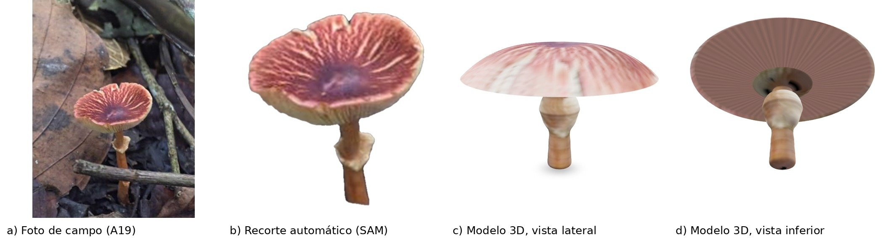

Nace de la salida de campo del 20 de octubre de 2026 de la asignatura Hongos y Oomicetos (Universidad Nacional de Colombia, Sede Palmira), con los docentes Carlos Alberto Huertas Davey y Eyder Daniel Gómez López.

| 70 fotos de campo | 32 géneros de hongos | 1 modelo 3D |
| :-: | :-: | :-: |

## Por qué digitalizar

Un hongo dura días; su registro puede durar siempre. La mayoría de los basidiomas se pudren en horas o días. Fotografiarlos bien y guardarlos en abierto convierte una salida de campo en un archivo útil para otros.

- **Conservación:** saber qué hongos hay, dónde y cuándo es la base para cuidar la diversidad fúngica de la reserva, que está poco estudiada.
- **Docencia:** un estudiante puede girar el hongo y ver píleo, láminas, anillo y estípite sin tener el espécimen.
- **Ciencia abierta:** fotos, datos y código quedan libres para revisar las identificaciones, repetir el método o sumar registros.

## Paso a paso: de una foto a un hongo en 3D

Así se hizo el registro CF-001 (*Leucoagaricus*, prob.) con una sola foto y herramientas gratuitas.

| | |
| :-: | :-: |
| 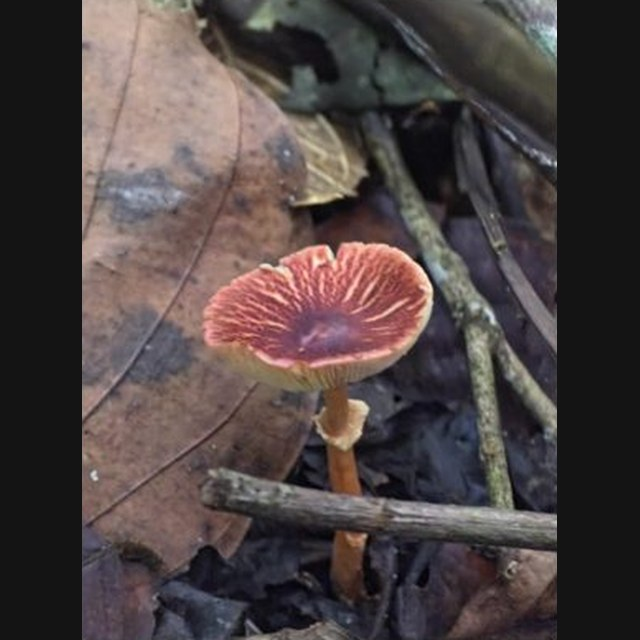 | 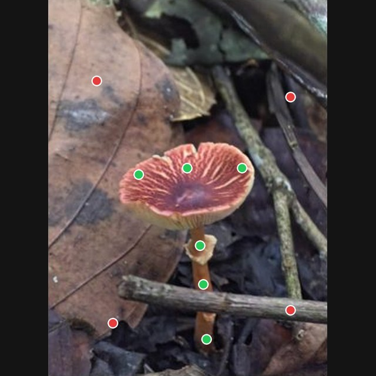 |
| **1. Fotografiar.** Foto de perfil, con sombrero, pie y anillo visibles (foto A19). | **2. Marcar.** Puntos verdes sobre el hongo y rojos sobre el fondo, para guiar a la IA. |
| 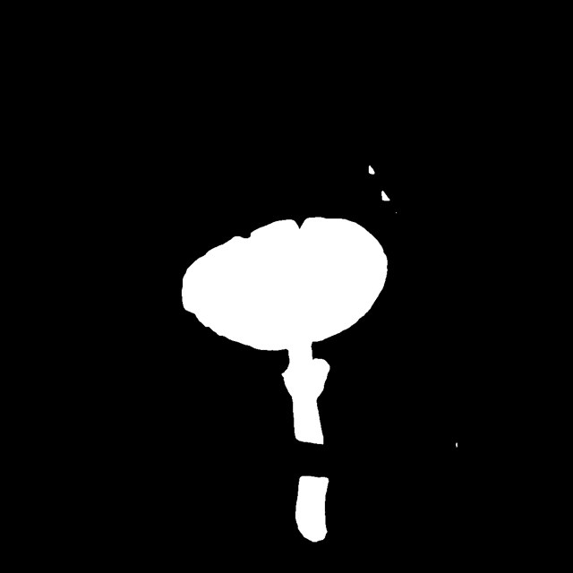 | 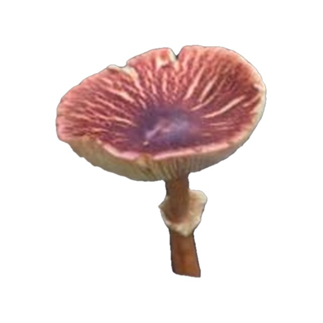 |
| **3. Segmentar.** SAM (*Segment Anything*) devuelve la máscara: blanco es hongo. | **4. Recortar.** Se aplica la máscara y queda el hongo solo, en PNG transparente. |
| 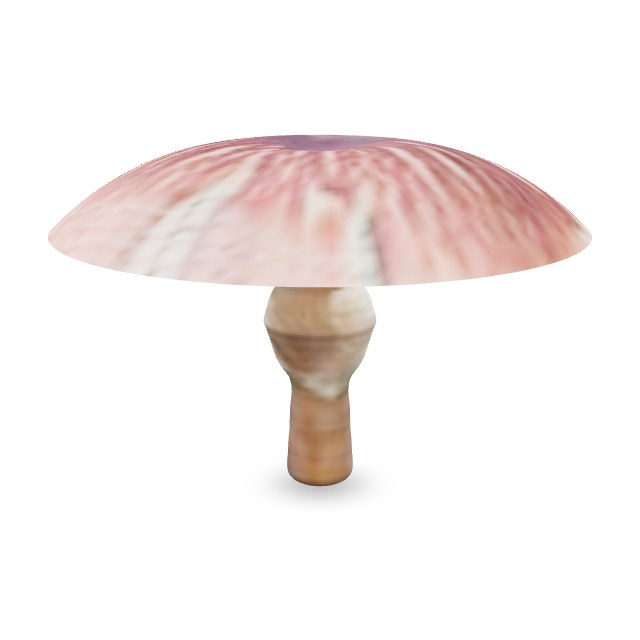 | 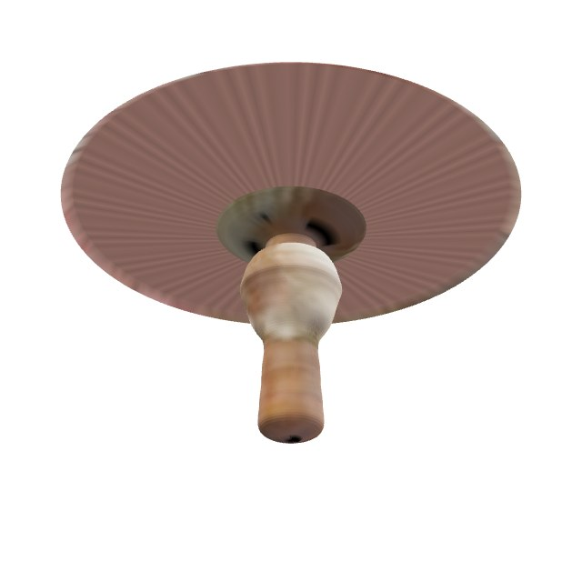 |
| **5. Reconstruir.** `hongo3d.py` endereza el sombrero a un disco y gira el pie sobre su eje. | **6. Publicar.** El `.glb` se abre en el navegador con *model-viewer*. |

**Herramientas:** Python · SAM (vía `rembg`) · `trimesh` · *model-viewer* · GitHub Pages.

```bash
pip install "rembg[cpu]" trimesh pillow scipy numpy
python pipeline/hongo3d.py recorte.png modelo.glb
```

El método supone simetría radial y completa las partes que no se ven (las láminas), así que sirve para ver la forma, no para medir. Para modelos fieles se recomienda fotogrametría (40 a 80 fotos alrededor del hongo). El protocolo completo está en [PROTOCOLO.md](PROTOCOLO.md).

## Registro fotográfico de la salida

Las 70 fotos están en `img/galeria/` y en la [galería del catálogo](https://jrojasvi-oss.github.io/catalogo-fungico-yotoco/#galeria), con su género tentativo en `datos/galeria.json`. Una muestra:

| | | | |
| :-: | :-: | :-: | :-: |
| 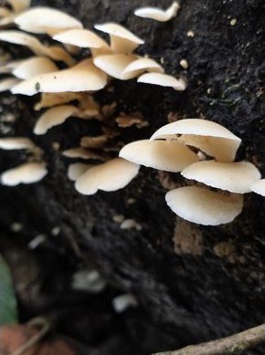 | 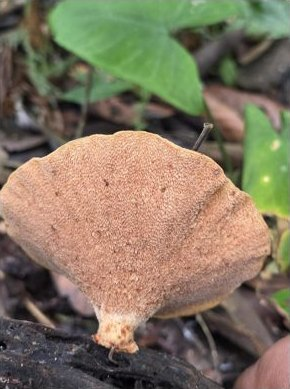 | 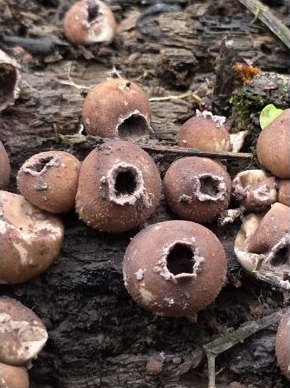 | 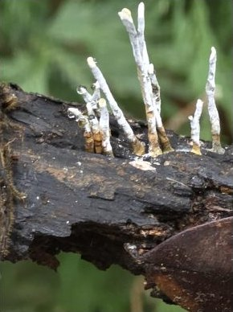 |
| *Pleurotus* | *Polyporus* s.l. | *Apioperdon* | *Xylaria* |
| 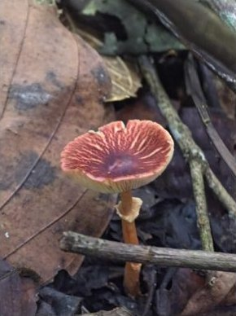 | 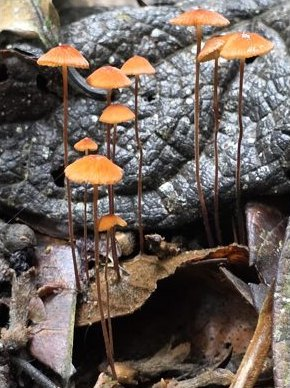 | 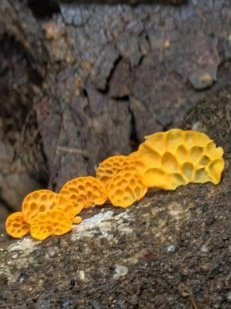 | 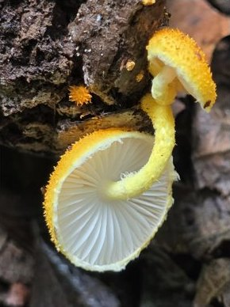 |
| *Leucoagaricus* (prob.) | *Marasmius* | *Favolaschia* | *Cyptotrama* |

Las identificaciones son tentativas, hechas a partir de fotografía, y esperan revisión docente.

## Fichas

| Código | Género | Sustrato | Modelo 3D | Estado |
| --- | --- | --- | --- | --- |
| CF-001 | *Leucoagaricus* (prob.) | Hojarasca | [CF-001_leucoagaricus.glb](modelos/CF-001_leucoagaricus.glb) | Pendiente revisión docente |

## Contenido del repositorio

| Carpeta | Qué tiene |
| --- | --- |
| `index.html` | La página del catálogo |
| `img/galeria/` | Las 70 fotos de la salida |
| `img/pasos/` | Imágenes del paso a paso |
| `modelos/` | Modelos 3D (`.glb`) |
| `datos/` | Fichas y galería en formato JSON |
| `pipeline/hongo3d.py` | Programa que convierte un recorte en modelo 3D |
| `informes/` | Informe de la salida y propuesta del catálogo (PDF) |
| `vendor/` | Visor *model-viewer* (Google, Apache 2.0) |

## Súmate

Este catálogo es de todos. ¿Ves una identificación equivocada? Abre un [issue](https://github.com/jrojasvi-oss/catalogo-fungico-yotoco/issues) con el número de la foto. ¿Visitas Yotoco? Toma fotos con el protocolo y compártelas: cada hongo nuevo es una ficha más.

## Licencia

Fotos, fichas y modelos: CC BY 4.0. Código: MIT. Autor: Juan David Rojas Villafañe, Ingeniería Agronómica, Universidad Nacional de Colombia, Sede Palmira.
